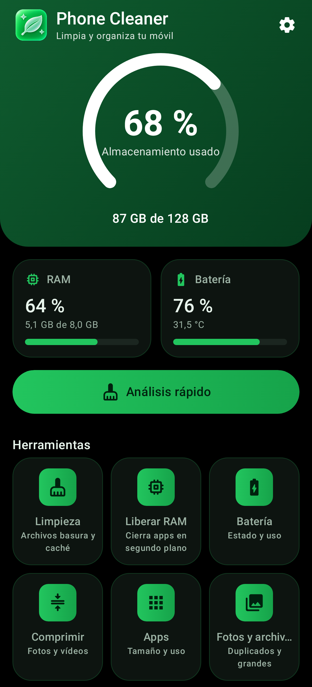

# Phone Cleaner

App Android para **limpiar y optimizar el móvil**: archivos basura, caché de las apps, RAM, batería, CPU y fotos o vídeos que ocupan demasiado. Está inspirada en el funcionamiento de CCleaner para Android, pero tiene identidad propia.

- **Interfaz:** blanco y verde en modo claro, negro puro (AMOLED) y verde en modo oscuro.
- **Idiomas:** español, e inglés si el móvil está en inglés.
- **Privacidad:** tus archivos, fotos y datos nunca salen del móvil.
- **Financiación:** anuncios de Google AdMob, que piden consentimiento según el RGPD, y un pago único para quitarlos (ver [Monetización](#monetización)).

| Inicio | Limpieza | Sistema | Archivos |
|---|---|---|---|
|  |  |  |  |
|  |  |  |  |

Todas las capturas, en claro y oscuro, están en [`docs/screenshots/`](docs/screenshots).

## Funciones

| Función | Qué hace |
|---|---|
| **Análisis rápido / Limpieza** | Busca miniaturas, temporales y registros, carpetas vacías, APK sobrantes, descargas antiguas y restos de apps desinstaladas. Las categorías dudosas vienen desmarcadas. En Android 11 o superior, **vacía la caché de todas las apps con un toque** usando la acción oficial del sistema. |
| **Liberar RAM** | Un toque y Phone Cleaner **llena la memoria unos segundos** para que el propio sistema de Android (el *low memory killer*) cierre las apps en segundo plano; Phone Cleaner no se cierra. Después suelta la memoria y muestra lo liberado de verdad, medido antes y después. Funciona en cualquier versión de Android, sin Accesibilidad, sin root y sin apps extra (detalles abajo). |
| **Gestor de apps** | Ordena por tamaño, nombre, instaladas hace poco o «se inician solas». Cada app tiene una ficha con su tamaño, fechas de instalación y actualización, si arranca sola al encender el móvil y su estado de batería. Se pueden detener o desinstalar varias a la vez. |
| **Batería** | Muestra nivel, salud, temperatura, voltaje, corriente, capacidad estimada y ciclos. También las **apps que se inician solas al encender el móvil**, las apps sin restricción de batería y accesos directos para ahorrar. |
| **Sistema (monitor)** | Muestra la CPU (frecuencia por núcleo y actividad estimada), la temperatura y el estado térmico, la RAM, el almacenamiento y la batería en tiempo real. Si el móvil se calienta, da consejos. |
| **Fotos y archivos** | Encuentra fotos **duplicadas** (copias exactas, comparadas por MD5), fotos **similares** (ráfagas, con hash perceptual), capturas de pantalla, vídeos grandes y archivos grandes. En Android 11 o superior, lo que borras va a la papelera del sistema y se puede recuperar durante 30 días; en Android 7–10 el borrado es definitivo y la app pide confirmación antes. |
| **Comprimir** | Recomprime **fotos** (JPEG al 85 %, misma resolución, conservando fecha, GPS y orientación) y **vídeos** (HEVC con Media3, con el bitrate que mantiene la calidad). Solo guarda el resultado si ahorra de verdad. Después ofrece mover los originales a la papelera. |
| **Ajustes** | Tema (según el sistema, claro u oscuro), recordatorio semanal de limpieza y estado de los permisos. |

### Lo que Android no permite (y cómo lo resuelve la app)

- Desde Android 14, una app normal **no puede cerrar otras apps** directamente.
- Ninguna app normal puede cambiar la velocidad de la CPU.
- Ninguna app normal puede leer el consumo exacto de batería de cada app.

Además, Android 15 marca como **«ajuste restringido»** varios permisos cuando la app se instala desde un APK descargado, fuera de una tienda: el acceso de uso, la Accesibilidad y mostrar sobre otras apps, entre otros. Esos permisos solo se pueden activar con un paso extra de seguridad. Por eso Phone Cleaner **no pide el acceso de uso ni la Accesibilidad**:

- **Liberar RAM por presión de memoria.** La app reserva memoria fuera del heap de Java (`SharedMemory`, o los píxeles de un `Bitmap` en Android 8.0) y la rellena con datos que no se pueden comprimir. Si no, la compresión zram del móvil la anularía. Ante esa presión, el *low memory killer* de Android cierra primero las apps en caché y en segundo plano. La app en pantalla es la última, así que Phone Cleaner sigue abierto.
- **Freno de seguridad.** La reserva se para antes del umbral de «memoria baja» de Android (con un margen), al llegar al 75 % de la RAM, a los 10 segundos o en cuanto el sistema avisa (`onTrimMemory`). Después se suelta toda la memoria, también si sales de la pantalla a mitad.
- **Contrapartida.** Las apps cerradas tardan algo más en abrirse la próxima vez, porque Android tiene que volver a cargarlas.
- **Datos de las apps sin permisos especiales.** El tamaño de cada app sale de sus APK y la lista de «apps que se inician solas» sale de los permisos que declaran. El tamaño de los datos y la caché de cada app solo se ve en sus Ajustes.
- **Caché de todas las apps.** Se vacía con la acción oficial del sistema (Android 11 o superior). Lo liberado se mide con el espacio libre antes y después.
- **CPU.** La carga se llama «actividad estimada», porque se calcula a partir de las frecuencias.

«Sin perder calidad» significa **sin diferencia visible**. Una compresión matemáticamente sin pérdida apenas ahorra espacio.

## Permisos

| Permiso | Para qué | Si no se concede |
|---|---|---|
| Acceso a todos los archivos (`MANAGE_EXTERNAL_STORAGE`) | Buscar basura y vaciar la caché de todas las apps | Solo se analiza la caché de las apps, y se vacía app por app |
| Fotos y vídeos (`READ_MEDIA_*`, `ACCESS_MEDIA_LOCATION`) | Duplicados, compresión y conservar el GPS de las fotos | No se pueden analizar ni comprimir fotos |
| Notificaciones | Recordatorio semanal y progreso de la compresión | No hay avisos |
| `INTERNET`, `ACCESS_NETWORK_STATE`, `AD_ID` (los añade el SDK de AdMob) | Cargar anuncios | — |
| `BILLING` (lo añade Google Play Billing) | Compra «Quitar anuncios» | — |
| `KILL_BACKGROUND_PROCESSES`, `REQUEST_DELETE_PACKAGES` | Refuerzo de «Liberar RAM» en Android 13 o inferior y desinstalar | — |

La visibilidad de otras apps se limita a las que tienen icono (`<queries>`). La app no usa `QUERY_ALL_PACKAGES`.

## Logo e iconos

El logo original está en `tools/logo_source.png`. El script `python3 tools/make_icon.py` genera a partir de él:
- el icono adaptativo, con un fondo de degradado vectorial y la hoja separada en primer plano;
- el icono monocromo, para los iconos temáticos;
- los iconos clásicos para Android 7;
- el logo que se ve dentro de la app;
- `docs/play-store-icon-512.png`, el icono para Google Play.

Todo sale en WebP.

## Compilar e instalar

Requisitos: JDK 17 o superior y el SDK de Android con la plataforma 37.

```bash
./gradlew :app:assembleDebug          # APK de prueba: app/build/outputs/apk/debug/app-debug.apk
./gradlew :app:testDebugUnitTest      # tests unitarios y de capturas
./gradlew :app:recordRoborazziDebug   # regenera las capturas de docs/screenshots
./gradlew :app:lintDebug
```

Para instalar el APK en tu móvil, cópialo al teléfono y ábrelo (tendrás que permitir «instalar apps desconocidas»), o usa `adb install app-debug.apk`.

Datos técnicos:

- Kotlin y Jetpack Compose con Material 3.
- minSdk 24 (Android 7.0), targetSdk 36 y compileSdk 37. No se puede bajar de 24 porque Navigation Compose lo exige. En Android 7, «Liberar RAM» usa `killBackgroundProcesses`, que en esa versión sí cierra otras apps.
- R8 activado en la versión release, que pesa unos 4,4 MB (APK).

## Publicar en Google Play

1. **Crea una clave de subida** una sola vez y guárdala bien, porque sin ella no podrás actualizar la app:
   ```bash
   keytool -genkeypair -v -keystore upload-key.jks -alias upload -keyalg RSA -keysize 2048 -validity 10000
   ```
2. **Crea `keystore.properties`** en la raíz del proyecto. Ya está en `.gitignore`, así que no se sube a git:
   ```properties
   storeFile=upload-key.jks
   storePassword=TU_CONTRASEÑA
   keyAlias=upload
   keyPassword=TU_CONTRASEÑA
   ```
3. **Genera el paquete con `./gradlew :app:bundleRelease`.** El resultado queda en `app/build/outputs/bundle/release/app-release.aab`.
4. En **Play Console**, crea la app, sube el `.aab` y rellena:
   - **Acceso a todos los archivos:** explica que es una app de limpieza y gestión de almacenamiento. Google puede rechazar este permiso. Si lo hace, quítalo del manifiesto: la app sigue funcionando sin él, aunque la limpieza queda limitada a la caché de cada app.
   - **Permisos de fotos y vídeos:** la función principal es encontrar duplicados y comprimir.
   - **Servicios en primer plano:** de tipo *procesamiento multimedia* y *sincronización de datos*, para comprimir vídeos.
   - **Contiene anuncios:** sí.
   - **Seguridad de los datos.** La app no envía archivos ni fotos a ningún sitio, pero el SDK de AdMob sí recopila y comparte con Google:
     - el identificador de publicidad y otros ID del dispositivo;
     - interacciones con los anuncios;
     - diagnósticos;
     - ubicación aproximada a partir de la IP.

     Todo con fines de publicidad, analítica y prevención de fraude. Marca también «los datos se cifran en tránsito». Google explica qué declarar en su guía de AdMob para el formulario de seguridad de datos.
   - **Política de privacidad:** publica [`PRIVACY.md`](PRIVACY.md) (por ejemplo con GitHub Pages) y pon su enlace en Play Console y en `admob.properties` → `privacyPolicyUrl`.
   - **Liberar RAM:** Google podría considerar que llenar la memoria para que Android cierre otras apps es «interferir con otras apps», según su política de abuso del dispositivo. Si lo rechaza, se puede dejar solo el refuerzo de Android 13 o inferior.
5. **Revisa el `applicationId`** (`com.ikeralvaro.phonecleaner`) antes de la primera subida, porque después no se puede cambiar.

### Formularios de Play Console

- [ ] **Permisos de fotos y vídeos** (`READ_MEDIA_IMAGES`/`READ_MEDIA_VIDEO`): justificar que duplicados y compresión son función principal; Android 14+ admite acceso parcial (`READ_MEDIA_VISUAL_USER_SELECTED`).
- [ ] **Acceso a todos los archivos** (`MANAGE_EXTERNAL_STORAGE`): declaración como app de limpieza/gestión de almacenamiento, con un **vídeo de demostración** (onboarding → conceder permiso → análisis y limpieza).
- [ ] **Servicios en primer plano:** declarar los tipos `dataSync` y `mediaProcessing` (compresión de vídeo) con un vídeo que muestre la notificación de progreso.
- [ ] **Seguridad de los datos:** SDK de AdMob (ID de publicidad, interacciones, diagnósticos, ubicación aproximada), consentimiento UMP y compras de Google Play Billing; datos cifrados en tránsito.
- [ ] **Público objetivo:** mayores de 13 años.
- [ ] **Clasificación de contenido:** cuestionario IARC.
- [ ] **Anuncios:** «Contiene anuncios: sí».
- [ ] **Política de privacidad:** URL pública de `PRIVACY.md`, con los datos del responsable rellenados.
- [ ] **Liberar RAM:** riesgo de política de abuso del dispositivo (ver arriba).

6. **Modo estricto de release:** `./gradlew :app:bundleRelease -Pstrict.release=true` (o con `CI=true`) falla si falta `admob.properties`; sin él solo avisa. La versión se fija con `appVersionCode`/`appVersionName` en `gradle.properties` o con `-P`.


## Monetización

La app tiene dos fuentes de ingresos:

| Fuente | Dónde | Detalle |
|---|---|---|
| **Anuncios nativos** | Inicio (bajo «Herramientas») y las pantallas de resultado: limpieza, RAM y compresión | Una tarjeta con el estilo de la app y la etiqueta «Anuncio». En los resultados lleva imagen o vídeo. |
| **Anuncio a pantalla completa** | Al salir de una pantalla de resultado | Nunca en la primera tarea, como mínimo 3 minutos entre anuncios y como mucho 6 al día (`AdFrequencyPolicy`). |
| **Quitar anuncios** | Ajustes | Compra única con Google Play Billing (producto `remove_ads`). |

Nunca hay anuncios al abrir la app, durante un análisis o limpieza, encima de botones ni fuera de la app. Así se cumplen las políticas de anuncios de AdMob y de Google Play.

### Ponerlo en marcha

1. **Crea una cuenta en [AdMob](https://admob.google.com)** y registra la app (Android, `com.ikeralvaro.phonecleaner`). Crea dos bloques de anuncios: **Nativo avanzado** e **Intersticial**.
2. **Crea `admob.properties`** en la raíz del proyecto. Ya está en `.gitignore`:
   ```properties
   appId=ca-app-pub-XXXXXXXXXXXXXXXX~YYYYYYYYYY
   nativeUnitId=ca-app-pub-XXXXXXXXXXXXXXXX/1111111111
   interstitialUnitId=ca-app-pub-XXXXXXXXXXXXXXXX/2222222222
   privacyPolicyUrl=https://tu-usuario.github.io/Phone-Cleaner/PRIVACY
   ```
   - La versión de depuración usa **siempre** los anuncios de prueba de Google («Test Ad»).
   - Si falta este archivo, la versión release también los usa, y la compilación lo avisa.
3. **Configura el consentimiento.** En AdMob → **Privacidad y mensajes**, crea el mensaje de RGPD (para la Unión Europea y Reino Unido). La app ya lo muestra con la plataforma UMP de Google y tiene «Privacidad de los anuncios» en Ajustes.
4. **Publica `app-ads.txt`** en la web de desarrollador que pongas en Play Console. Sin él, AdMob limita los anuncios.
5. **Crea el producto en Play Console.** Ve a Monetizar → Productos → Productos de compra única, crea el producto `remove_ads` con el precio que quieras (por ejemplo 2,99 €) y actívalo. Para probarlo sin pagar, añade tu cuenta en **Configuración → Pruebas de licencia**.
6. **Nunca pulses tus propios anuncios reales.** AdMob puede suspender la cuenta. Para probar, usa la versión de depuración.

**Verificación de la compra.** No hay servidor propio, así que la compra se comprueba en el móvil al arrancar (`queryPurchasesAsync`). También detecta los reembolsos. Si más adelante quieres más seguridad, puedes verificar los tokens con la Google Play Developer API desde un servidor.

### Qué esperar en ingresos

Lo que más influye es el **número de usuarios activos al día**, no el número de anuncios. Cifras orientativas por cada 1000 impresiones en España:
- anuncio nativo: 0,50–2 €;
- anuncio a pantalla completa: 2–8 €.

Por ejemplo, con 1000 usuarios diarios que vean unos 3 nativos y 1 pantalla completa, salen unos 5–15 € al día. Con pocos usuarios, serán céntimos. Para ganar más, lo eficaz es conseguir instalaciones y buenas valoraciones; poner más anuncios no ayuda.

## Lista de pruebas en un móvil real

- [ ] El onboarding concede cada permiso y vuelve a la app con el estado actualizado.
- [ ] El análisis rápido encuentra basura y «Limpiar» libera lo indicado.
- [ ] «Vaciar caché de todas las apps» muestra el diálogo del sistema y después la cifra liberada (Android 11 o superior).
- [ ] Liberar RAM funciona. Para comprobarlo:
  1. Abre varias apps pesadas y entra en Liberar RAM.
  2. Pulsa el botón. El anillo debe subir y bajar, y Phone Cleaner no debe cerrarse.
  3. La cifra liberada debe ser mayor que 0.
  4. Al volver a «Apps recientes», las otras apps tienen que recargarse.
- [ ] Borrar una foto duplicada la manda a la papelera (Android 11+); en Android 7–10 pide confirmación y la borra definitivamente.
- [ ] Al comprimir una foto, la copia conserva la fecha y la ubicación.
- [ ] Al comprimir un vídeo, se ve igual y ocupa menos.
- [ ] Cambiar entre tema claro y oscuro funciona, y el modo «según el sistema» sigue al móvil.
- [ ] Con el móvil en inglés, la app aparece en inglés.
- [ ] Anuncios en la versión de depuración, que solo usa anuncios de prueba:
  - aparece el formulario de consentimiento (si estás en la UE);
  - en Inicio y en «¡Listo!» se ve una tarjeta «Test Ad»;
  - al salir de una segunda limpieza (o pasados 3 minutos) aparece la pantalla completa.
- [ ] La compra de prueba de «Quitar anuncios» (con una cuenta de pruebas de licencia) quita todos los anuncios. Al reinstalar la app, la compra se recupera.

## Estructura

```
app/src/main/java/com/ikeralvaro/phonecleaner/
  core/        permisos, lectores del sistema (RAM, almacenamiento, batería, CPU, temperatura), utilidades
  feature/     home, cleaner, boost, apps, battery, monitor, media, compress, settings, onboarding
  ui/          tema verde/blanco/negro, componentes y navegación
app/src/test/  tests de la lógica (reglas de basura, hashes de fotos, compresión…) y capturas de pantalla
docs/          especificación de diseño y capturas
```
