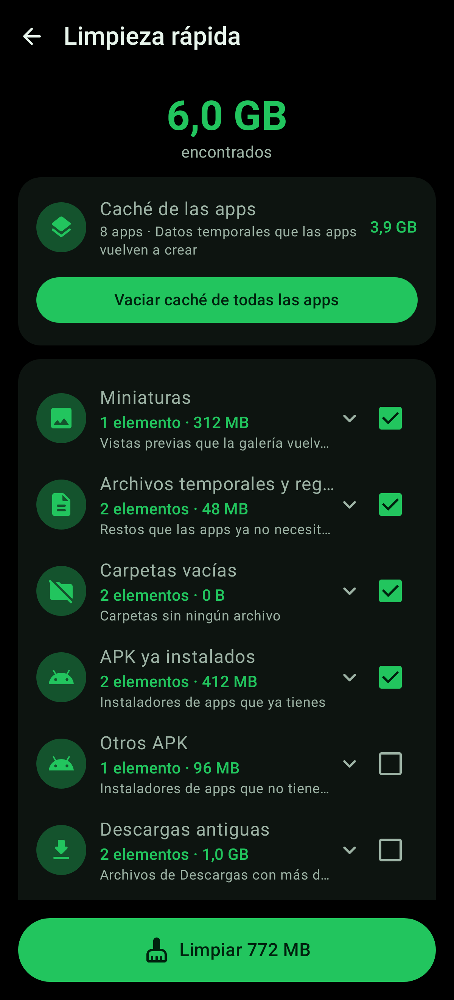
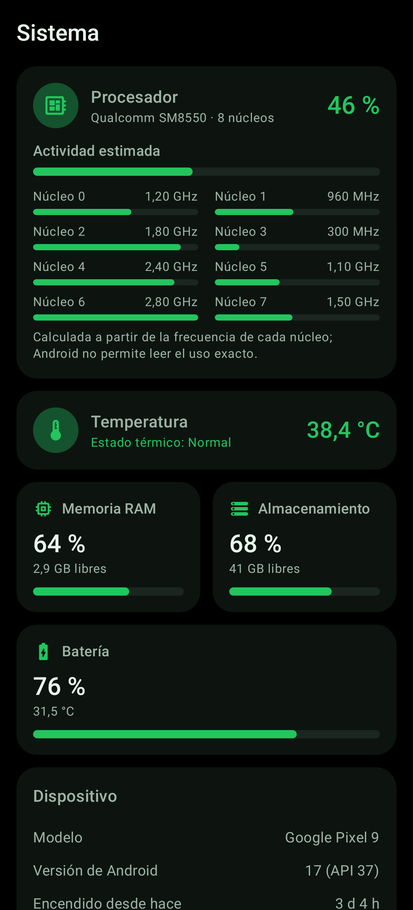
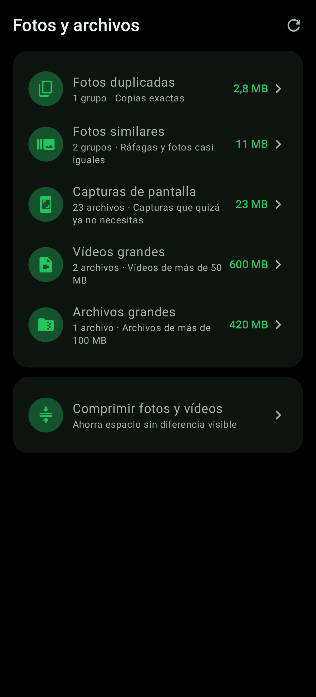

# Phone Cleaner

App Android para **limpiar y optimizar el móvil**: archivos basura, caché de las apps, RAM, batería, CPU y fotos o vídeos que ocupan demasiado. Está inspirada en el funcionamiento de CCleaner para Android, pero tiene identidad propia.

- **Interfaz:** blanco y verde en modo claro, negro puro (AMOLED) y verde en modo oscuro.
- **Idiomas:** español, e inglés si el móvil está en inglés.
- **Privacidad:** 100 % sin conexión, sin anuncios ni rastreo. La app ni siquiera pide el permiso de Internet.

| Inicio | Limpieza | Sistema | Archivos |
|---|---|---|---|
|  |  |  |  |
|  |  |  |  |

Todas las capturas, en claro y oscuro, están en [`docs/screenshots/`](docs/screenshots).

## Funciones

| Función | Qué hace |
|---|---|
| **Análisis rápido / Limpieza** | Busca miniaturas, temporales y registros, carpetas vacías, APK sobrantes, descargas antiguas y restos de apps desinstaladas. Las categorías dudosas vienen desmarcadas. En Android 11 o superior, **vacía la caché de todas las apps con un toque** usando la acción oficial del sistema. |
| **Liberar RAM** | Mide la RAM libre antes y después, y muestra solo lo liberado de verdad. En Android 13 o inferior detiene las apps en segundo plano. En Android 14 o superior usa una **detención rápida guiada**: abre la ficha de cada app para que pulses «Forzar detención». |
| **Gestor de apps** | Ordena las apps por tamaño, caché, uso, «sin usar en 30 días» o recientes. Cada app tiene una ficha con el desglose de espacio, su uso y su estado de batería, y se pueden detener o desinstalar varias a la vez. |
| **Batería** | Muestra nivel, salud, temperatura, voltaje, corriente, capacidad estimada y ciclos. También las apps con más tiempo de uso, las apps sin restricción de batería y accesos directos para ahorrar. |
| **Sistema (monitor)** | Muestra la CPU (frecuencia por núcleo y actividad estimada), la temperatura y el estado térmico, la RAM, el almacenamiento y la batería en tiempo real. Si el móvil se calienta, da consejos. |
| **Fotos y archivos** | Encuentra fotos **duplicadas** (copias exactas, comparadas por MD5), fotos **similares** (ráfagas, con hash perceptual), capturas de pantalla, vídeos grandes y archivos grandes. Lo que borras va a la papelera del sistema y se puede recuperar durante 30 días. |
| **Comprimir** | Recomprime **fotos** (JPEG al 85 %, misma resolución, conservando fecha, GPS y orientación) y **vídeos** (HEVC con Media3, con el bitrate que mantiene la calidad). Solo guarda el resultado si ahorra de verdad. Después ofrece mover los originales a la papelera. |
| **Ajustes** | Tema (según el sistema, claro u oscuro), recordatorio semanal de limpieza y estado de los permisos. |

### Lo que Android no permite (y cómo lo resuelve la app)

Desde Android 8, **ninguna app** de Google Play puede cerrar otras apps por su cuenta, cambiar la velocidad de la CPU ni leer el consumo exacto de batería de cada app. Las apps que prometen «acelerar la CPU» o enseñan animaciones de «impulso» con cifras inventadas incumplen las políticas de Play. Por eso Phone Cleaner:

- mide la RAM y el almacenamiento antes y después, y muestra solo lo que se ha liberado de verdad;
- llama «actividad estimada» a la carga de CPU, porque la calcula a partir de las frecuencias;
- muestra el **tiempo de uso** de cada app en lugar de un «consumo» que no puede conocer;
- no usa el servicio de Accesibilidad, que Google Play restringe mucho.

«Sin perder calidad» significa **sin diferencia visible**. Una compresión matemáticamente sin pérdida apenas ahorra espacio.

## Permisos

| Permiso | Para qué | Si no se concede |
|---|---|---|
| Acceso a todos los archivos (`MANAGE_EXTERNAL_STORAGE`) | Buscar basura y vaciar la caché de todas las apps | Solo se analiza la caché de las apps, y se vacía app por app |
| Acceso de uso (`PACKAGE_USAGE_STATS`) | Tamaño, caché y uso de cada app | No se ven los tamaños ni el uso |
| Fotos y vídeos (`READ_MEDIA_*`, `ACCESS_MEDIA_LOCATION`) | Duplicados, compresión y conservar el GPS de las fotos | No se pueden analizar ni comprimir fotos |
| Notificaciones | Recordatorio semanal y progreso de la compresión | No hay avisos |
| `KILL_BACKGROUND_PROCESSES`, `REQUEST_DELETE_PACKAGES` | Liberar RAM (Android 13 o inferior) y desinstalar | — |

La visibilidad de otras apps se limita a las que tienen icono (`<queries>`). La app no usa `QUERY_ALL_PACKAGES`.

## Compilar e instalar

Requisitos: JDK 17 o superior y el SDK de Android con la plataforma 37.

```bash
./gradlew :app:assembleDebug          # APK de prueba: app/build/outputs/apk/debug/app-debug.apk
./gradlew :app:testDebugUnitTest      # tests unitarios y de capturas
./gradlew :app:recordRoborazziDebug   # regenera las capturas de docs/screenshots
./gradlew :app:lintDebug
```

Para instalar el APK en tu móvil, cópialo al teléfono y ábrelo (tendrás que permitir «instalar apps desconocidas»), o usa `adb install app-debug.apk`.

Datos técnicos:

- Kotlin y Jetpack Compose con Material 3.
- minSdk 26 (Android 8), targetSdk 36 y compileSdk 37.
- R8 activado en la versión release, que pesa unos 2 MB.

## Publicar en Google Play

1. **Crea una clave de subida** una sola vez y guárdala bien, porque sin ella no podrás actualizar la app:
   ```bash
   keytool -genkeypair -v -keystore upload-key.jks -alias upload -keyalg RSA -keysize 2048 -validity 10000
   ```
2. **Crea `keystore.properties`** en la raíz del proyecto. Ya está en `.gitignore`, así que no se sube a git:
   ```properties
   storeFile=upload-key.jks
   storePassword=TU_CONTRASEÑA
   keyAlias=upload
   keyPassword=TU_CONTRASEÑA
   ```
3. **Genera el paquete con `./gradlew :app:bundleRelease`.** El resultado queda en `app/build/outputs/bundle/release/app-release.aab`.
4. En **Play Console**, crea la app, sube el `.aab` y rellena:
   - **Acceso a todos los archivos:** explica que es una app de limpieza y gestión de almacenamiento. Google puede rechazar este permiso. Si lo hace, quítalo del manifiesto: la app sigue funcionando sin él, aunque la limpieza queda limitada a la caché de cada app.
   - **Permisos de fotos y vídeos:** la función principal es encontrar duplicados y comprimir.
   - **Servicios en primer plano:** de tipo *procesamiento multimedia* y *sincronización de datos*, para comprimir vídeos.
   - **Seguridad de los datos:** no se recopila ni se comparte ningún dato, porque la app funciona sin conexión.
5. **Revisa el `applicationId`** (`com.ikeralvaro.phonecleaner`) antes de la primera subida, porque después no se puede cambiar.

## Lista de pruebas en un móvil real

- [ ] El onboarding concede cada permiso y vuelve a la app con el estado actualizado.
- [ ] El análisis rápido encuentra basura y «Limpiar» libera lo indicado.
- [ ] «Vaciar caché de todas las apps» muestra el diálogo del sistema y después la cifra liberada (Android 11 o superior).
- [ ] Liberar RAM funciona: en Android 14 o superior, recorre las fichas de las apps seleccionadas.
- [ ] Borrar una foto duplicada la manda a la papelera.
- [ ] Al comprimir una foto, la copia conserva la fecha y la ubicación.
- [ ] Al comprimir un vídeo, se ve igual y ocupa menos.
- [ ] Cambiar entre tema claro y oscuro funciona, y el modo «según el sistema» sigue al móvil.
- [ ] Con el móvil en inglés, la app aparece en inglés.

## Estructura

```
app/src/main/java/com/ikeralvaro/phonecleaner/
  core/        permisos, lectores del sistema (RAM, almacenamiento, batería, CPU, temperatura), utilidades
  feature/     home, cleaner, boost, apps, battery, monitor, media, compress, settings, onboarding
  ui/          tema verde/blanco/negro, componentes y navegación
app/src/test/  tests de la lógica (reglas de basura, hashes de fotos, compresión…) y capturas de pantalla
docs/          especificación de diseño y capturas
```
